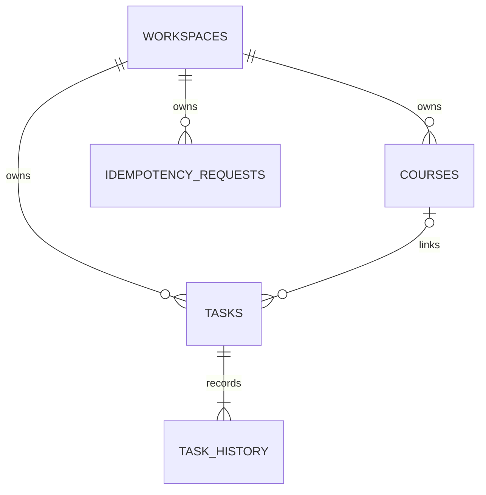

# 백엔드 저장 모델

작성 기준: 2026-11-24. PostgreSQL을 사용합니다. 이 문서와 [테이블 설계안](schema.sql)은 설계 산출물이며 실행 중인 애플리케이션에 적용하지 않았습니다. DB의 지원 버전·보안 패치와 JDBC·마이그레이션 도구의 호환성은 의존성을 실제 추가할 때 다시 확인합니다.

## 구현 순서와 범위

- [x] 현재 프론트엔드와 기획서의 학기·과목·과제 규칙 대조
- [x] 수동 관리의 저장 모델·소유권·API 계약 설계
- [ ] PostgreSQL 연결과 마이그레이션, 게스트 세션·소유권 검증 구현 — 바로 다음 단계
- [ ] 과목·수동 과제·변경 이력 API 구현과 실제 DB 통합 테스트
- [ ] 프론트엔드 API 연결과 기존 로컬 과목 데이터의 명시적 가져오기
- [ ] 공지·분석 후보·검토 결과·알림의 서버 저장과 트랜잭션 확장
- [ ] 실제 iClass 수집·AI 분석·알림 발송 연동

첫 구현은 가입 없이 학기·과목·수동 과제를 관리하고 다시 접속해도 저장한 데이터를 읽는 범위입니다. 목 데이터는 서버에 자동 저장하지 않습니다. 기획서의 과제 취소·삭제·실행 취소, 수업 기준 마감 후보 계산, 전체 데이터 백업·삭제는 현재 화면에서 모두 구현된 기능이 아니므로 별도 작업으로 남깁니다. 이번 API 계약에도 아직 포함하지 않습니다.

## 가입 없는 시작과 데이터 소유권

학교 로그인은 수집 권한을 얻는 연결입니다. 개인 작업 공간의 접근 권한과 분리합니다. 회원 계정·기기 간 동기화는 후속 범위입니다.

1. `GET /api/v1/session`이 Spring의 세션과 CSRF 토큰을 준비합니다. 서버가 생성한 `ownerKey`를 세션 속성에 보관합니다.
2. `POST /api/v1/workspace/start`가 해당 `ownerKey`에 작업 공간 하나를 연결합니다. 같은 세션에서 다시 호출하면 기존 공간을 반환하고 선택 학기를 덮어쓰지 않습니다. 동시 요청도 DB의 `owner_key UNIQUE`로 중복을 막습니다.
3. 이후의 모든 조회·변경은 세션에서 얻은 작업 공간으로 제한합니다. 요청 본문·헤더의 임의 `userId`, `ownerKey`, `workspaceId`를 소유권 근거로 사용하지 않습니다.
4. 다른 작업 공간의 과목·과제·이력 ID를 요청하면 존재 여부를 공개하지 않고 `404`를 반환합니다. 세션이나 작업 공간 연결이 없으면 `401`입니다.

세션은 Spring Session JDBC로 유지할 계획입니다. 프레임워크 세션 테이블은 사용할 버전의 공식 스키마에 따라 별도 마이그레이션으로 추가합니다. 세션 ID를 직접 인증 토큰으로 구현하거나 평문 비밀을 업무 테이블에 저장하지 않습니다. 세션 ID 변경 시에도 `ownerKey` 속성을 유지합니다.

운영 쿠키는 `HttpOnly`, `Secure`, `SameSite=Lax`, 호스트 전용으로 설정하고 요청 본문·쿠키·CSRF 토큰을 로그에서 제외합니다. 세션·개인 데이터 응답은 `Cache-Control: no-store`로 반환합니다. 개발은 현재의 루프백 바인딩과 Vite `/api` 프록시를 사용합니다. 쿠키 인증의 쓰기 요청에는 CSRF 검증을 적용하고, 허용 출처를 전역으로 열지 않습니다.

게스트 방식은 쿠키 삭제나 세션 만료 후 본인 확인으로 기록을 되찾는 수단이 없습니다. 공개 서비스로 전환하기 전 세션 유지 기간·복구 수단·접근 불가능해진 기록의 보관/삭제 정책을 정해야 합니다. 세션을 자동 재발급해 기존 공간에 연결하는 동작은 허용하지 않습니다.

기획서의 최초 저장 안내는 기기 저장을 기준으로 합니다. 원격 서버에 배포할 경우 저장 위치가 달라지므로 **프론트엔드 API 연결 단계에서 저장 위치·보관·복구 한계를 먼저 안내**해야 합니다. 로컬 과목 백업이나 예시 데이터를 사용자의 동의 없이 서버로 가져오지 않습니다.

## 관계

학기는 `2026-1`, `2026-summer`, `2026-2`, `2026-winter` 형태의 공용 값입니다. 실제 학사 일정이나 마감일로 학기를 추정하지 않습니다. 빈 학기도 선택할 수 있으므로 과목·과제가 있어야 학기를 만드는 구조는 사용하지 않습니다. 유효 연도는 현재 프론트엔드와 같은 `1000..9999`입니다.

| 테이블 | 주요 값 | 무결성·조회 기준 |
| --- | --- | --- |
| `workspaces` | 내부 `owner_key`, 선택 학기, `revision` | `owner_key`당 하나, API에는 내부 키를 노출하지 않음 |
| `courses` | 학기, 과목명·분반, 정규화 키, 수업 요일·시각, `revision`, `deleted_at` | 살아 있는 과목의 `(workspace, term, name_key, section_key)` 중복 금지 |
| `tasks` | 연결 과목 ID 또는 직접 입력, 소속 학기·과목·분반 사본, 제목, 마감, 진행 상태, 조건·메모, `revision` | 복합 FK로 같은 소유자의 과목만 연결. 소속 학기 필수 |
| `task_history` | 과제 버전, 생성/직접 수정, 변경 전후 JSON, 발생 시각 | `(workspace, task, version)` 유일. 저장된 내용 수정 금지 |
| `idempotency_requests` | 생성 요청 키·해시, 처리 결과, 만료 시각 | 같은 공간의 같은 키로 생성 요청을 반복해도 중복 생성 금지 |

모든 업무 ID는 서버가 생성한 UUID입니다. 프론트엔드 예시 ID를 실 데이터 ID로 재사용하지 않습니다. `revision`은 양의 정수이며 JSON에서 안전하게 표현할 수 있는 범위까지만 사용합니다.

### 과목과 수업 시간

- 과목명은 1~100자, 분반은 1~30자입니다. NFC 정규화·앞뒤 공백 제거 후 저장하고, 중복 검사 키는 `Locale.ROOT` 소문자화를 적용합니다. 정규화 키는 서버에서만 만듭니다.
- API 요일은 ISO `1=월요일 .. 7=일요일`의 중복 없는 배열입니다. DB에서는 7비트 정수로 저장합니다. 월요일은 비트 0, 일요일은 비트 6입니다.
- 요일이 없으면 시작 시각도 `null`, 요일이 있으면 `HH:mm` 시작 시각이 필수입니다. 초·`24:00`은 받지 않습니다.
- 과목 수정으로 연결 과제의 학기·과목명·분반이 달라지면, 같은 트랜잭션에서 해당 과제 사본도 갱신하고 과제 버전과 `manual-edit` 이력을 추가합니다. 시간표만 바뀌면 과제 값·이력은 바꾸지 않습니다. 이는 현재 화면의 과목 변경 표시를 보존하면서 서버에서는 변경 근거를 남기는 확장입니다.
- 과목 삭제는 `deleted_at`으로 처리합니다. 과제·이력·과목 ID와 마지막 과목 정보는 보존합니다. 삭제된 과목을 새 과제에 연결할 수는 없습니다. 기존 과제의 동일 연결과 학기·과목명·분반을 그대로 유지하는 수정은 허용합니다. 다른 과목 연결 또는 직접 입력 전환도 가능합니다.
- 과목 수정·삭제와 과제 저장은 과목 행을 먼저 잠그고, 연결 과제는 ID 순으로 잠가 경합을 처리합니다. 갱신 도중 일부 과제만 바뀐 상태로 커밋하지 않습니다.

### 과제와 마감

| 값 | API | Java | PostgreSQL |
| --- | --- | --- | --- |
| 학기 | 필수 문자열 | 검증된 값 객체 | `varchar(11)` |
| 마감 날짜 | `YYYY-MM-DD` 또는 `null` | `LocalDate` | `date` |
| 마감 시각 | `HH:mm` 또는 `null` | `LocalTime` | `time without time zone` |
| 마감 시간대 | `Asia/Seoul` | `ZoneId` | 고정 값 |
| 생성·변경 시점 | UTC ISO 8601 | `Instant` | `timestamptz` |

날짜와 시각을 따로 저장하므로 ‘날짜만 확정’, ‘날짜·시각 모두 미정’, 명시적 `00:00`을 구분합니다. 날짜 없이 시각만 저장하지 않습니다. 미정 시각을 `23:59`나 자정으로 채우지 않습니다. 날짜는 실제 달력 날짜이며 `1000-01-01..9999-12-31`로 제한합니다.

진행 상태는 기존 화면의 `todo`, `in-progress`, `written`, `submitted` 네 가지입니다. `written`은 미제출입니다. `submitted`는 사용자 표시이며 학교 제출 API를 호출하지 않습니다. 원천은 첫 구현에서 서버가 설정하는 `manual`뿐입니다. 예시 표시 색상·선택 날짜·펼침 상태는 DB에 저장하지 않습니다.

제목 1~150자, 제출 형식·분량 각 100자 이하, 메모 20,000자 이하입니다. 공백뿐인 필수 값은 거부합니다. 길이 제한은 기존 폼과 같은 UTF-16 코드 단위로 서버에서도 검사하며 DB의 문자 수 제한은 추가 방어입니다.

제출 URL은 `null` 또는 최대 2,048자의 HTTP(S) URL입니다. 사용자 정보와 제어 문자를 거부하고, 서버가 링크를 직접 요청하지 않습니다. 외부 링크 수집 기능을 추가할 때 SSRF 방어를 별도로 구현합니다.

### 변경 이력·충돌·재시도

- 과제 생성은 버전 1과 `created` 이력을 같은 트랜잭션에서 기록합니다. 변경은 `expectedRevision` 일치 확인 후 버전을 1 올리고 변경 전후 사본을 기록합니다. 실패하면 과제·이력 모두 롤백합니다.
- 값이 같은 저장은 버전·이력을 추가하지 않습니다. 오래된 `expectedRevision`은 값이 같더라도 `409 REVISION_CONFLICT`입니다. 프론트엔드는 다시 조회하고 사용자 확인 후 저장합니다.
- 연결 과목의 `courseRevision`도 저장 시 확인합니다. 화면을 연 뒤 과목이 바뀌거나 삭제되었으면 `409 COURSE_CHANGED`로 다시 선택하게 합니다. 이미 삭제된 연결을 유지하는 경우만 `courseRevision: null`을 허용합니다.
- 생성 API의 `Idempotency-Key`는 UUID이고 공간별로 구분합니다. 정규화된 요청과 작업 경로의 SHA-256 해시, 응답 상태·본문을 함께 기록합니다. 같은 키·같은 요청은 최초 결과를, 다른 요청은 `409 IDEMPOTENCY_CONFLICT`를 반환합니다. 동시 요청도 한 번만 반영합니다.
- 키 보관 기간은 최초 처리 후 24시간입니다. 이 기간이 지난 생성 요청을 프론트엔드가 자동 재전송하지 않습니다. 목록을 다시 확인해 중복 여부를 확인합니다. 수정 요청의 응답을 잃은 경우에는 재조회와 버전 확인을 사용합니다.
- 이력 JSON은 버전이 있는 전체 업무 값 사본입니다. UI 표현 문자열을 영구 포맷으로 사용하지 않습니다. 런타임 DB 역할에는 이력 행 수정·삭제 권한을 부여하지 않습니다. 사용자 데이터 삭제 정책은 별도 기능으로 정의합니다.

### 목록과 독립 일정

메인 목록과 집계는 같은 학기·기간·키워드·과목명·상태 조건과 같은 DB 스냅샷을 사용합니다. 페이지가 나뉘어도 집계는 필터 결과 전체 기준입니다. `all`, `week`, `month`, `undated` 기간을 지원합니다. 이번 주는 한국 시간 월~일, 이번 달은 1일~말일이며 응답에 실제 범위와 `asOf`를 돌려줍니다. 제출 건수도 제출 시각이 아니라 과제 마감일로 셉니다. 정렬은 마감 날짜, 시각, 제목, ID 순이며 `null` 마감은 뒤로 둡니다.

‘전체 과제’는 현재 필터의 총수, ‘남은 과제’는 그중 `submitted`가 아닌 수, ‘마감 미정’은 그중 날짜가 없는 수입니다. 시각 미정은 날짜 미정과 다릅니다.

`GET /api/v1/schedule`은 같은 학기의 지정한 주 미제출 과제만 날짜별로 반환합니다. 메인 목록 필터를 받지 않습니다. 모바일에서도 미리보기와 과제 목록은 독립적입니다. 주 시작일은 월요일이어야 하고, 응답에 7일 범위가 들어갈 수 없는 경계 날짜는 거부합니다.

## 후속 모델의 경계

공지의 외부 ID·원문 버전, 분석 실행의 모델·지시문 버전, 후보의 원문 근거, 검토 결과, 알림 작업은 후속 마이그레이션에서 추가합니다. AI 초안을 확정 과제로 저장하지 않습니다. 검토 반영은 과제·이력·검토 완료·공지 상태·앱 내 알림을 한 트랜잭션에 묶고, 외부 발송은 커밋 후 실행할 작업을 같은 트랜잭션에 기록하는 방식으로 확장합니다. 알림을 실제 발송한 것으로 미리 표시하지 않습니다.

## 구현 시 검증할 시나리오

- [ ] DB를 비운 상태의 최초 적용과 재기동 후 데이터 복원
- [ ] 세션 없음·다른 소유자 ID·CSRF 누락 요청 거부
- [ ] 같은 과목 동시 생성과 같은 생성 키의 동시 재시도
- [ ] 과제 저장·이력 저장 중 실패 시 전체 롤백
- [ ] 오래된 과제·과목 버전의 수정 거부
- [ ] 과목 수정 전파·삭제 후 과제 보존과 새 연결 차단
- [ ] 날짜/시각 미정, 명시적 자정, 윤년, 주·월·연도 경계
- [ ] 목록 페이지와 전체 집계 일치, 일정 미리보기의 독립성
- [ ] 예시·로그·오류 응답·백업에 비밀이 포함되지 않음

## 근거

로컬 기획 `01_요구사항정의서_v1.0.xlsx`의 `요구사항!A6:E11`, `A19:E20`, `A30:E52`와 현재 프론트엔드 모델을 대조했습니다. 원본은 저장소 밖 참고 폴더에 보존합니다.

- [PostgreSQL 제약 조건](https://www.postgresql.org/docs/current/ddl-constraints.html): 소유권 복합 FK, 유일성·검사 제약.
- [PostgreSQL 날짜와 시각](https://www.postgresql.org/docs/current/datatype-datetime.html): 날짜/시각과 발생 시점의 타입 구분.
- [PostgreSQL JSON 타입](https://www.postgresql.org/docs/current/datatype-json.html): 검증된 이력 사본에 `jsonb` 사용.
- [Spring Security CSRF](https://docs.spring.io/spring-security/reference/servlet/exploits/csrf.html): 쿠키 인증 쓰기 요청의 검증.
