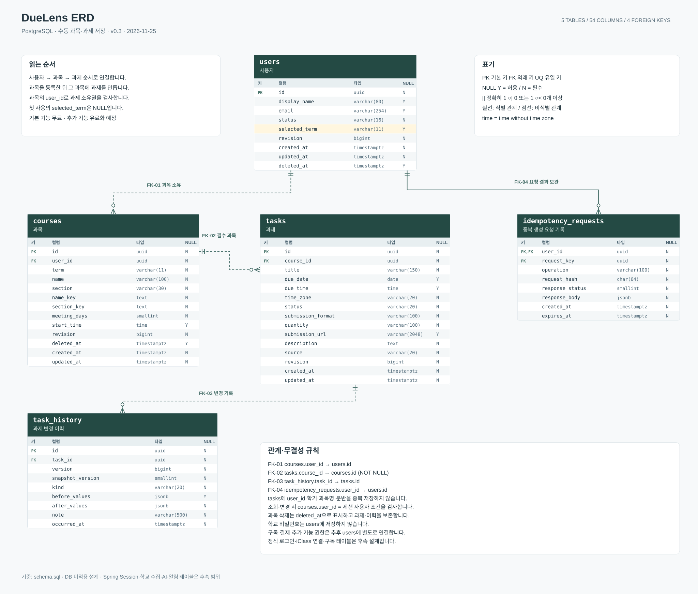

# 컬럼·제약 참고

v0.3 · 2026-11-25. DB 설계서는 [ERD](erd.md)로 관리합니다. 이 문서는 SQL의 컬럼·기본값·제약·인덱스를 읽기 위한 참고 자료입니다. 5개 테이블·54개 컬럼·4개 FK이며 동일한 업무 DDL을 로컬 PostgreSQL 18.7에 적용·검증했습니다. [ERD](erd.md), [DDL](schema.sql), [업무 규칙](data-model.md), [API 계약](api.md)을 함께 관리합니다.

## 테이블·컬럼 정의

### users

DueLens 사용자 정보와 선택 학기

기본 키: `id`. 백엔드가 UUID와 시각을 생성합니다.

| 컬럼 | 타입 | NULL | 기본값 | 설명 |
| --- | --- | --- | --- | --- |
| `id` (PK) | `uuid` | 불가 | 미지정 | 서버에서 생성하는 UUID 식별자 |
| `display_name` | `varchar(80)` | 허용 | 미지정 | 사용자 표시 이름. 게스트는 NULL 허용 |
| `email` | `varchar(254)` | 허용 | 미지정 | 연락 이메일. 게스트는 NULL이며 이메일을 로그인 식별자로 간주하지 않음 |
| `status` | `varchar(16)` | 불가 | 'guest' | 사용자 상태: guest / active / withdrawn |
| `selected_term` | `varchar(11)` | 허용 | NULL | 현재 선택 학기. 첫 사용의 미선택은 NULL |
| `revision` | `bigint` | 불가 | 1 | 낙관적 잠금용 버전. 의미 있는 변경마다 증가 |
| `created_at` | `timestamptz` | 불가 | 미지정 | 최초 생성 시점 |
| `updated_at` | `timestamptz` | 불가 | 미지정 | 마지막 변경 시점 |
| `deleted_at` | `timestamptz` | 허용 | 미지정 | 탈퇴 표시 시점. withdrawn이면 필수 |

제약 조건:

- `id`: `PRIMARY KEY`
- `display_name`: `CHECK (display_name IS NULL OR char_length(btrim(display_name)) > 0)`
- `status`: `NOT NULL DEFAULT 'guest' CHECK (status IN ('guest', 'active', 'withdrawn'))`
- `selected_term`: `DEFAULT NULL CHECK (selected_term IS NULL OR selected_term ~ '^[1-9][0-9]{3}-(1|summer|2|winter)$')`
- `revision`: `NOT NULL DEFAULT 1 CHECK (revision BETWEEN 1 AND 9007199254740991)`
- `created_at`: `NOT NULL`
- `updated_at`: `NOT NULL`
- `CHECK ((status = 'withdrawn' AND deleted_at IS NOT NULL) OR (status IN ('guest', 'active') AND deleted_at IS NULL))`

### courses

사용자별 학기·과목·분반과 수업 시간

기본 키: `id`. 백엔드가 UUID와 시각을 생성합니다.

| 컬럼 | 타입 | NULL | 기본값 | 설명 |
| --- | --- | --- | --- | --- |
| `id` (PK) | `uuid` | 불가 | 미지정 | 서버에서 생성하는 UUID 식별자 |
| `user_id` | `uuid` | 불가 | 미지정 | DueLens 소유 사용자 ID |
| `term` | `varchar(11)` | 불가 | 미지정 | 명시적으로 정한 소속 학기 |
| `name` | `varchar(100)` | 불가 | 미지정 | 과목명 |
| `section` | `varchar(30)` | 불가 | 미지정 | 분반 |
| `name_key` | `text` | 불가 | 미지정 | 과목명의 NFC·trim·Locale.ROOT 소문자 중복 검사 키 |
| `section_key` | `text` | 불가 | 미지정 | 분반의 NFC·trim·Locale.ROOT 소문자 중복 검사 키 |
| `meeting_days` | `smallint` | 불가 | 0 | 수업 요일 7비트. 월요일 bit0~일요일 bit6, 0은 요일 없음 |
| `start_time` | `time without time zone` | 허용 | 미지정 | 한국 기준 수업 시작 시각. 초·24:00 불가 |
| `revision` | `bigint` | 불가 | 1 | 낙관적 잠금용 버전. 의미 있는 변경마다 증가 |
| `deleted_at` | `timestamptz` | 허용 | 미지정 | 삭제 표시 시점. null이면 활성 과목 |
| `created_at` | `timestamptz` | 불가 | 미지정 | 최초 생성 시점 |
| `updated_at` | `timestamptz` | 불가 | 미지정 | 마지막 변경 시점 |

제약 조건:

- `id`: `PRIMARY KEY`
- `user_id`: `NOT NULL REFERENCES users(id)`
- `term`: `NOT NULL CHECK (term ~ '^[1-9][0-9]{3}-(1|summer|2|winter)$')`
- `name`: `NOT NULL CHECK (char_length(btrim(name)) > 0)`
- `section`: `NOT NULL CHECK (char_length(btrim(section)) > 0)`
- `name_key`: `NOT NULL CHECK (char_length(name_key) BETWEEN 1 AND 300)`
- `section_key`: `NOT NULL CHECK (char_length(section_key) BETWEEN 1 AND 90)`
- `meeting_days`: `NOT NULL DEFAULT 0 CHECK (meeting_days BETWEEN 0 AND 127)`
- `revision`: `NOT NULL DEFAULT 1 CHECK (revision BETWEEN 1 AND 9007199254740991)`
- `created_at`: `NOT NULL`
- `updated_at`: `NOT NULL`
- `CHECK ((meeting_days = 0 AND start_time IS NULL) OR (meeting_days > 0 AND start_time IS NOT NULL))`
- `CHECK (start_time IS NULL OR (start_time < time '24:00' AND extract(second FROM start_time) = 0))`

### tasks

등록한 과목에 속하는 과제와 마감·진행 상태

기본 키: `id`. 백엔드가 UUID와 시각을 생성합니다.

| 컬럼 | 타입 | NULL | 기본값 | 설명 |
| --- | --- | --- | --- | --- |
| `id` (PK) | `uuid` | 불가 | 미지정 | 서버에서 생성하는 UUID 식별자 |
| `course_id` | `uuid` | 불가 | 미지정 | 필수 등록 과목 ID. 과제 소유권과 학기는 이 과목을 통해 확인 |
| `title` | `varchar(150)` | 불가 | 미지정 | 과제명 |
| `due_date` | `date` | 허용 | 미지정 | 한국 기준 마감 날짜. 날짜 미정이면 null |
| `due_time` | `time without time zone` | 허용 | 미지정 | 마감 시각. 시각 미정이면 null. 날짜 없이 시각만 저장 불가 |
| `time_zone` | `varchar(20)` | 불가 | 'Asia/Seoul' | 마감 시간대 Asia/Seoul 고정 |
| `status` | `varchar(20)` | 불가 | 미지정 | todo / in-progress / written / submitted |
| `submission_format` | `varchar(100)` | 불가 | '' | 제출 형식 |
| `quantity` | `varchar(100)` | 불가 | '' | 분량 |
| `submission_url` | `varchar(2048)` | 허용 | 미지정 | 선택 HTTP(S) URL. 서버에서 접속하지 않음 |
| `description` | `text` | 불가 | '' | 과제 안내·메모 |
| `source` | `varchar(20)` | 불가 | 'manual' | 첫 구현은 서버가 manual로 설정 |
| `revision` | `bigint` | 불가 | 1 | 낙관적 잠금용 버전. 의미 있는 변경마다 증가 |
| `created_at` | `timestamptz` | 불가 | 미지정 | 최초 생성 시점 |
| `updated_at` | `timestamptz` | 불가 | 미지정 | 마지막 변경 시점 |

제약 조건:

- `id`: `PRIMARY KEY`
- `course_id`: `NOT NULL REFERENCES courses(id)`
- `title`: `NOT NULL CHECK (char_length(btrim(title)) > 0)`
- `due_date`: `CHECK (due_date BETWEEN date '1000-01-01' AND date '9999-12-31')`
- `time_zone`: `NOT NULL DEFAULT 'Asia/Seoul' CHECK (time_zone = 'Asia/Seoul')`
- `status`: `NOT NULL CHECK (status IN ('todo', 'in-progress', 'written', 'submitted'))`
- `submission_format`: `NOT NULL DEFAULT ''`
- `quantity`: `NOT NULL DEFAULT ''`
- `description`: `NOT NULL DEFAULT '' CHECK (char_length(description) <= 20000)`
- `source`: `NOT NULL DEFAULT 'manual' CHECK (source = 'manual')`
- `revision`: `NOT NULL DEFAULT 1 CHECK (revision BETWEEN 1 AND 9007199254740991)`
- `created_at`: `NOT NULL`
- `updated_at`: `NOT NULL`
- `CHECK (due_time IS NULL OR due_date IS NOT NULL)`
- `CHECK (due_time IS NULL OR (due_time < time '24:00' AND extract(second FROM due_time) = 0))`

### task_history

과제 버전별 변경 전후 값

기본 키: `id`. 백엔드가 UUID와 시각을 생성합니다.

| 컬럼 | 타입 | NULL | 기본값 | 설명 |
| --- | --- | --- | --- | --- |
| `id` (PK) | `uuid` | 불가 | 미지정 | 서버에서 생성하는 UUID 식별자 |
| `task_id` | `uuid` | 불가 | 미지정 | 이력이 속한 과제 ID |
| `version` | `bigint` | 불가 | 미지정 | 해당 과제의 변경 버전. 최초 등록은 1 |
| `snapshot_version` | `smallint` | 불가 | 1 | 이력 JSON 데이터 형식 버전 1 |
| `kind` | `varchar(20)` | 불가 | 미지정 | created 또는 manual-edit |
| `before_values` | `jsonb` | 허용 | 미지정 | 변경 전 TaskSnapshot JSON. 최초 등록은 null |
| `after_values` | `jsonb` | 불가 | 미지정 | 변경 후 TaskSnapshot JSON. 필수 객체 |
| `note` | `varchar(500)` | 불가 | '' | 변경 사유 안내 |
| `occurred_at` | `timestamptz` | 불가 | 미지정 | 변경 발생 시점 |

제약 조건:

- `id`: `PRIMARY KEY`
- `task_id`: `NOT NULL REFERENCES tasks(id)`
- `version`: `NOT NULL CHECK (version BETWEEN 1 AND 9007199254740991)`
- `snapshot_version`: `NOT NULL DEFAULT 1 CHECK (snapshot_version = 1)`
- `kind`: `NOT NULL CHECK (kind IN ('created', 'manual-edit'))`
- `after_values`: `NOT NULL CHECK (jsonb_typeof(after_values) = 'object')`
- `note`: `NOT NULL DEFAULT ''`
- `occurred_at`: `NOT NULL`
- `UNIQUE (task_id, version)`
- `CHECK ((kind = 'created' AND version = 1 AND before_values IS NULL) OR (kind = 'manual-edit' AND version > 1 AND before_values IS NOT NULL AND jsonb_typeof(before_values) = 'object'))`

### idempotency_requests

사용자별 생성 요청의 중복 반영 방지

기본 키: `user_id, request_key`. 백엔드가 UUID와 시각을 생성합니다.

| 컬럼 | 타입 | NULL | 기본값 | 설명 |
| --- | --- | --- | --- | --- |
| `user_id` (PK) | `uuid` | 불가 | 미지정 | DueLens 소유 사용자 ID |
| `request_key` (PK) | `uuid` | 불가 | 미지정 | Idempotency-Key UUID. 같은 공간에서 중복 금지 |
| `operation` | `varchar(100)` | 불가 | 미지정 | 생성 작업의 메서드·경로 |
| `request_hash` | `char(64)` | 불가 | 미지정 | 정규화 요청과 작업 경로의 SHA-256 소문자 16진수 |
| `response_status` | `smallint` | 불가 | 미지정 | 성공한 생성의 HTTP 상태 200 고정 |
| `response_body` | `jsonb` | 불가 | 미지정 | success:true인 최초 공통 응답 JSON 전체 |
| `created_at` | `timestamptz` | 불가 | 미지정 | 최초 생성 시점 |
| `expires_at` | `timestamptz` | 불가 | 미지정 | 최초 성공 처리 24시간 후의 키 만료 시점 |

제약 조건:

- `user_id`: `NOT NULL REFERENCES users(id)`
- `request_key`: `NOT NULL`
- `operation`: `NOT NULL`
- `request_hash`: `NOT NULL CHECK (request_hash ~ '^[0-9a-f]{64}$')`
- `response_status`: `NOT NULL CHECK (response_status = 200)`
- `response_body`: `NOT NULL CHECK (jsonb_typeof(response_body) = 'object')`
- `created_at`: `NOT NULL`
- `expires_at`: `NOT NULL`
- `PRIMARY KEY (user_id, request_key)`
- `CHECK (expires_at > created_at)`

## 외래 키

| 자식 | 부모 | 삭제 정책 |
| --- | --- | --- |
| courses (user_id) | users (id) | NO ACTION. 연쇄 삭제 없음 |
| tasks (course_id) | courses (id) | NO ACTION. 연쇄 삭제 없음 |
| task_history (task_id) | tasks (id) | NO ACTION. 연쇄 삭제 없음 |
| idempotency_requests (user_id) | users (id) | NO ACTION. 연쇄 삭제 없음 |

과제의 사용자·학기·과목명·분반은 courses에서 확인합니다. tasks에 중복 소유 FK나 과목 사본을 두지 않습니다. 서버는 모든 조회·변경에서 과목의 user_id가 세션 사용자와 같은지 검사합니다. 과목 삭제는 deleted_at으로 표시하고 기존 과제·이력을 보존합니다.

## 인덱스

| 이름 | 테이블 | 컬럼 | 유일성 | 조건 |
| --- | --- | --- | --- | --- |
| courses_active_identity | courses | user_id, term, name_key, section_key | UNIQUE | WHERE deleted_at IS NULL |
| tasks_course_deadline | tasks | course_id, due_date, due_time, id | 일반 | 없음 |
| courses_user_term | courses | user_id, term, id | 일반 | 없음 |
| idempotency_requests_expiry | idempotency_requests | expires_at | 일반 | 없음 |

기본 키·UNIQUE의 인덱스는 PostgreSQL이 생성합니다. task_history(task_id, version)의 UNIQUE로 과제별 이력을 조회합니다.

## 확장과 적용 상태

기본 기능 무료·추가 기능 유료 방향은 확정했고 요금·대상 기능·결제 제공자는 미정입니다. 추후 구독·결제·기능 이용 권한은 users.id에 연결하는 별도 테이블로 설계합니다. 결제 여부를 사용자 상태나 iClass 연결 여부로 대신하지 않습니다.

- [x] 사용자 정보와 사용자 → 과목 → 과제 관계 정의
- [x] 필수 과목 FK·과목에서 파생하는 과제 표시 값 정의
- [x] 로컬 PostgreSQL V1 업무 스키마·V2 실행 권한 적용
- [ ] 사용자 세션·소유권 검사 구현
- [ ] 정식 로그인·iClass 연결·구독·결제 설계 및 구현
