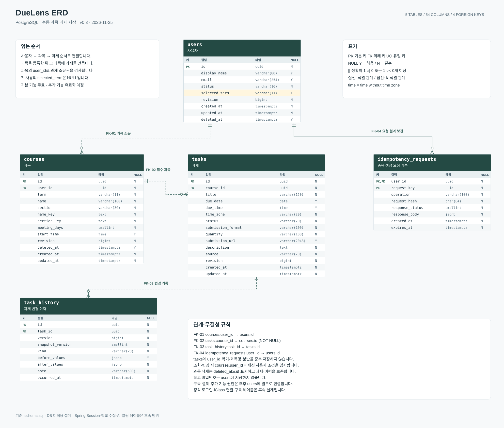

# DueLens ERD

v0.3 · 2026-11-25. **사용자 → 과목 → 과제** 관계의 PostgreSQL 물리 설계입니다. 5개 테이블·54개 컬럼·4개 FK를 정의했으며 동일한 업무 DDL을 로컬 PostgreSQL 18.7에 Flyway V1으로 적용했습니다. 그림은 v0.3 작성 당시의 설계 원본이고, 현재 적용 상태·권한·검증 결과는 [DB 구성 기록](postgresql-setup.md)에 있습니다.

- [크게 보기](erd.svg)
- [draw.io 편집 원본](erd.drawio)
- [Mermaid 원본](erd.mmd)
- [컬럼 정의](database-design.md) · [SQL](schema.sql) · [업무 규칙](data-model.md)

## 온라인 편집

- [draw.io에서 ERD 편집](https://app.diagrams.net/#G1ZmESFjSJPDzykLZIlq29fSvNyXQpD7BR)
- [Gmail Drive 원본](https://drive.google.com/file/d/1ZmESFjSJPDzykLZIlq29fSvNyXQpD7BR/view)
- [DueLens 폴더](https://drive.google.com/drive/folders/1bCAmPA9NrT56GlZ-8qqbvPw7berb7Fas)

온라인 편집본과 저장소의 draw.io·SVG·SQL은 자동 동기화되지 않습니다. 설계 변경 시 함께 갱신합니다. 공유 권한은 소유자에게만 공개로 유지합니다.

2026-11-25에 Gmail Drive 원본을 v0.3으로 갱신하고 저장·파일명 변경 후 새로고침해 users와 4개 관계선을 확인했습니다.

## 핵심 관계

| 부모 | 자식 FK | 부모 한 건당 자식 | 자식 한 건당 부모 |
| --- | --- | --- | --- |
| users.id | courses.user_id | 0..N 과목 | 사용자 1명 필수 |
| courses.id | tasks.course_id | 0..N 과제 | 과목 1개 필수 |
| tasks.id | task_history.task_id | 0..N 이력 | 과제 1개 필수 |
| users.id | idempotency_requests.user_id | 0..N 요청 기록 | 사용자 1명 필수 |

과목을 먼저 등록하고 그 과목에 과제를 만듭니다. tasks.course_id는 NOT NULL이며 과목 연결을 생략할 수 없습니다. 과제에 사용자 FK를 별도로 두지 않고 과목의 user_id로 소유자를 확인합니다. 학기·과목명·분반도 과목에서 조회합니다.

FK는 연결 대상의 존재를 보장합니다. 서버가 조회·생성·수정·이력 조회마다 courses.user_id가 세션 사용자와 같은지 검사해야 타인의 데이터에 접근하지 못합니다. UUID를 알고 있다는 사실만으로 접근을 허용하지 않습니다.

이력의 0..N은 FK가 표현하는 물리 관계입니다. 서비스에서는 과제 생성과 최초 이력 한 건을 한 트랜잭션으로 기록합니다. 과목 삭제는 행 삭제 대신 deleted_at으로 표시해 과제와 이력을 보존합니다.

## 사용자와 서비스 확장

users는 DueLens 사용자 ID·표시 이름·연락 이메일·상태·선택 학기·생성·변경·탈퇴 시점을 관리합니다. 가입 없는 시작도 guest 사용자 행으로 구분하고 정식 계정 연결 시 같은 ID를 유지하도록 설계합니다. 현재 로그인·계정 연결은 미구현입니다.

iClass는 학교 데이터 접근용 연결이며 DueLens 사용자 테이블을 대체하지 않습니다. 학교 비밀번호는 users에 저장하지 않습니다. 공식 로그인 연동·안정적인 식별자 제공 여부는 아직 확인하지 않았습니다.

기본 기능 무료·추후 추가 기능 유료화가 제품 방향입니다. 구독·결제·기능 이용 권한은 users.id에 별도로 연결할 후속 범위입니다. 요금·유료 기능은 미정이며 현재 그림에 구현 테이블로 추가하지 않았습니다.

## 읽는 방법

상자는 테이블, 각 행은 컬럼입니다. PK는 기본 키, FK는 외래 키, UQ는 유일 키입니다. NULL의 Y는 생략 가능, N은 필수입니다. `||`는 정확히 하나, 원과 갈퀴는 0개 이상입니다. 점선은 FK가 자식 PK에 포함되지 않는 관계, 실선은 포함되는 관계입니다. [Crow’s Foot 표기](https://www.drawio.com/docs/tutorials/crows-foot-notation/)

## 검증·다음 단계

- [x] 사용자 정보와 사용자 → 과목 → 과제 관계 개정
- [x] 과목 FK 필수화·과제의 중복 사용자·과목 표시 컬럼 제거
- [x] API 요청·응답과 모델의 필수 courseId·파생 표시 값 구분
- [x] API·모델·오류코드 명세와 SQL·SVG·draw.io의 구조 대조
- [x] 온라인 ERD 저장·재열기 확인
- [x] 화면의 과목 등록 필수 흐름 반영
- [x] PostgreSQL 초기 마이그레이션·DB 실행 권한·롤백 통합 검증
- [ ] 사용자 세션·CSRF·업무 데이터 소유권 검사
- [ ] 정식 로그인·iClass·구독·결제 설계 및 구현
